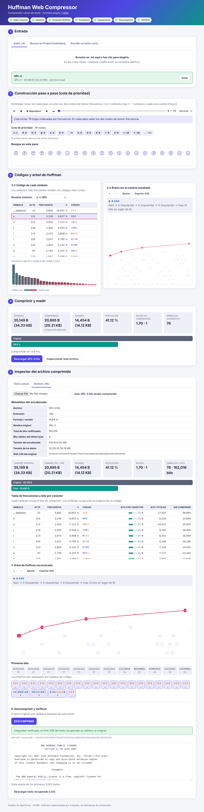
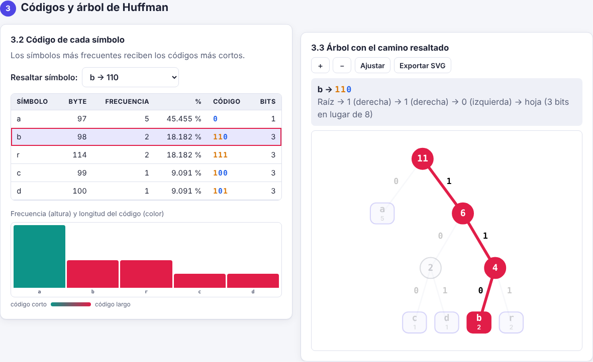
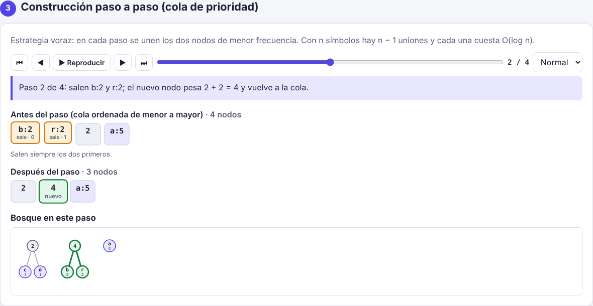
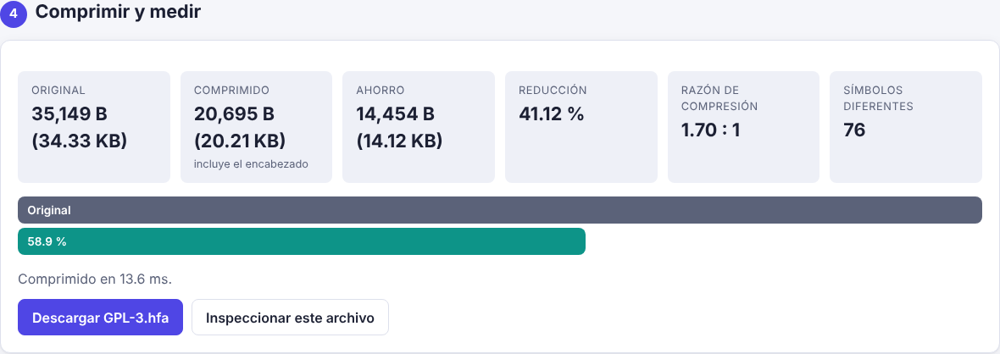
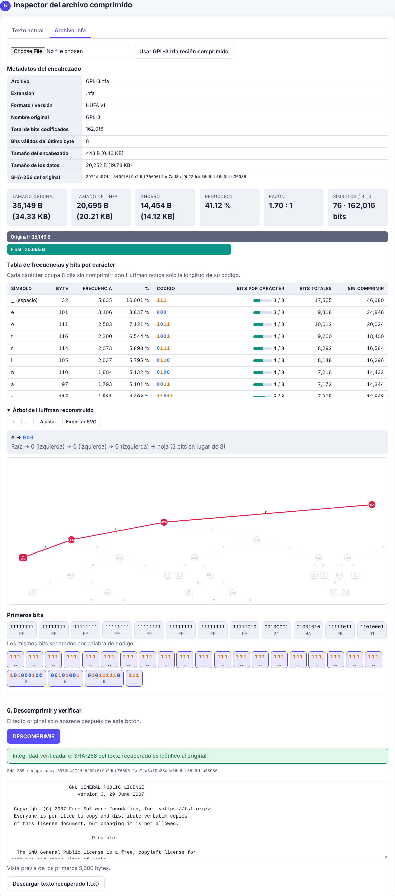

# Huffman Web Compressor

Aplicación web que comprime y descomprime archivos de texto con el **algoritmo de Huffman** (técnica voraz), usando un formato de archivo propio: **`.hfa`**. Huffman está implementado por el equipo con solo la biblioteca estándar (cola de prioridad, `struct`/`DataView` y SHA-256); no se usa ninguna biblioteca de compresión.

> Proyecto de la materia Análisis de Algoritmos · 2026B.



## Equipo
**Nombre del equipo:** _(por definir)_

| Integrante | Rol Scrum | Usuario de GitHub |
|---|---|---|
| _Johan Daniel Gutierrez Nava_ | Scrum Master | _Souls-Nao_ |
| _Oswaldo Daniel Castañeda Hernández_ | Desarrollo | _OswalSnow_ |
| _Cuauhtémoc Soria Hernández_ | Desarrollo | _IlSorialI_ |
| _Omar Alejandro Ruvalcaba Velazquez_ | Desarrollo | _omarruvalcaba0282-eng_ |

## Enlaces
- Aplicación Streamlit (referencia): https://huffman-brigada-binaria.streamlit.app
- Aplicación web JS: _(URL de GitHub Pages, pendiente de publicar)_
- Tablero GitHub Projects: https://github.com/users/Souls-Nao/projects/6

## Características
| Característica | Dónde |
|---|---|
| Subir `.txt`, escribir un texto corto o **buscar en Project Gutenberg** (título, autor o tema) | `web/src/modules/input` |
| **Construcción paso a paso** con la cola de prioridad (min-heap): qué dos nodos salen, el nodo nuevo y el bosque parcial | `modules/steps` |
| **Árbol de Huffman gráfico** (SVG) con zoom, arrastre y exportación; al elegir un símbolo se **resalta su camino de bits** desde la raíz | `modules/tree` |
| Tabla de códigos y gráfica frecuencia vs. longitud del código | `modules/tree` |
| **Inspector**: frecuencias, bits por carácter (vs. 8), tamaño final vs. original, metadatos del `.hfa`, árbol reconstruido, primeros bits por palabra de código | `modules/inspector` |
| Comprimir, métricas y descarga del `.hfa`; **DESCOMPRIMIR** con verificación **SHA-256** | `modules/compress`, `modules/inspector` |
| Formato `.hfa` idéntico byte a byte al de la versión Python | [`docs/FORMATO.md`](docs/FORMATO.md) |

| Árbol y camino resaltado | Paso a paso |
|---|---|
|  |  |

| Comprimir y medir | Inspector y descompresión |
|---|---|
|  |  |

## Instalación y ejecución
Requisitos: **Node.js 20 o superior** (la app y las pruebas no tienen dependencias que instalar). Python 3.12 solo para la versión de referencia.

```bash
git clone https://github.com/Souls-Nao/huffman-web-compressor.git
cd huffman-web-compressor/web
npm start            # http://localhost:8080  (sirve la app y el proxy de Gutenberg)
npm test             # 43 pruebas: núcleo, módulos, integración y compatibilidad con Python
npm run evidencias   # regenera ../evidencias/RESULTADOS.md
```

Versión Python (Streamlit): `pip install -r requirements.txt && streamlit run app.py` y `python -m unittest`. Tiene las mismas secciones que la versión JS: entrada (archivo, **Gutenberg** o texto escrito), construcción **paso a paso**, **árbol gráfico** con el camino de un símbolo, bits por símbolo, inspector del `.hfa` y descompresión con SHA-256.

### Publicar (gratis)
1. **Proxy de Gutenberg** (Cloudflare Workers, plan gratuito): `cd web && npx wrangler deploy proxy/worker.js --name huffman-gutenberg --compatibility-date 2026-01-01`.
2. Poner la URL resultante en `web/src/modules/input/config.js` (`GUTENBERG_PROXY`).
3. En GitHub: *Settings → Pages → Source: GitHub Actions*. El flujo `.github/workflows/pages.yml` publica `web/` en cada merge a `main`.

### Streamlit: despliegue y proxy de Gutenberg
- **Despliegue.** Streamlit Community Cloud vuelve a desplegar cuando hay un push a la rama configurada en *App → Settings* (normalmente `main`) y ejecuta el *Main file path* (`app.py`). Si una mejora está en otra rama, no aparece hasta que se hace merge a esa rama.
- **Proxy.** Si gutenberg.org está en mantenimiento o bloquea la IP del servidor, la búsqueda falla con un mensaje claro y las pestañas *Subir .txt* y *Escribir un texto* siguen funcionando. Para rodear el bloqueo, en *Settings → Secrets* (o en `.streamlit/secrets.toml`, ver `.streamlit/secrets.toml.example`) define `GUTENBERG_PROXY_URL` con la URL del Worker de `web/proxy/worker.js` (el mismo de la versión JS) y/o `GUTENBERG_HTTP_PROXY` con un proxy HTTP(S). También se leen como variables de entorno. Con proxy inverso, si este falla se intenta gutenberg.org directo.

## Guía de uso
1. **Entrada.** Sube un `.txt`, escribe un texto (por ejemplo `abracadabra`) o busca un libro y pulsa *Usar este libro*.
2. **Construcción.** Usa el deslizador de *paso a paso* para ver cómo salen siempre los dos nodos de menor frecuencia.
3. **Códigos y árbol.** Elige un símbolo (lista, tabla o clic en una hoja): el camino se resalta y se explica bit por bit.
4. **Comprimir y medir.** Pulsa *Comprimir*, revisa las métricas y descarga el `.hfa`.
5. **Inspector.** *Inspeccionar este archivo* (o sube un `.hfa`) muestra su estructura **sin el texto original**.
6. **DESCOMPRIMIR.** Recupera el texto, verifica el SHA-256 y permite descargarlo.

## Arquitectura
```
web/src/core/       lógica pura: frecuencias, árbol (min-heap), códigos, bits, formato .hfa, compresor, layout
web/src/app/        store, helpers DOM seguros (sin innerHTML), barra de flujo
web/src/modules/    input · steps · tree · compress · inspector  (viewmodel puro + vista DOM + css)
web/proxy/          worker.js (proxy CORS de Gutenberg) y dev-server.mjs
web/tests/          pruebas del núcleo, integración y compatibilidad con Python
huffman/ · app.py   versión Python/Streamlit (referencia)
```
Detalle, contratos entre módulos y guía de migración a React Native Web: [`docs/ARQUITECTURA_WEB.md`](docs/ARQUITECTURA_WEB.md).

## El algoritmo en una línea
Contar frecuencias → unir siempre los **dos nodos de menor frecuencia** con una cola de prioridad hasta tener una raíz → código = camino (izquierda `0`, derecha `1`) → empaquetar bits en bytes → guardar la **tabla de frecuencias** (no el árbol) para reconstruirlo al descomprimir. Con `n` símbolos distintos (n ≤ 256) el árbol cuesta **O(n log n)** y codificar el texto **O(L)**. Análisis completo: [`docs/REPORTE_TECNICO.md`](docs/REPORTE_TECNICO.md).

## Resultados
Medidos con `npm run evidencias` (detalle y SHA-256 en [`evidencias/RESULTADOS.md`](evidencias/RESULTADOS.md)):

| Texto | Original | `.hfa` | Reducción | Idéntico |
|---|---|---|---|---|
| GPL-3 | 35,149 B | 20,699 B | 41.11 % | ✅ |
| Apache-2.0 | 11,358 B | 6,770 B | 40.39 % | ✅ |
| GFDL-1.3 | 22,955 B | 13,576 B | 40.86 % | ✅ |
| Don Quijote (Gutenberg #2000, medido con la versión Python) | 2,225,803 B | 1,270,569 B | 42.92 % | ✅ |

## Pruebas
`npm test` ejecuta 43 pruebas con `node:test`: ejemplo `abracadabra` calculado a mano, ausencia de prefijos, empaquetado de bits, ida y vuelta (vacío, un símbolo, acentos, `\r\n`, Latin-1, los 256 bytes y 200 entradas aleatorias), detección de archivos dañados, parser de Gutenberg, proxy y **compatibilidad byte a byte con el compresor Python** (cada lado lee el `.hfa` del otro).

## Limitaciones conocidas
- En textos muy pequeños el `.hfa` pesa más que el original: el encabezado (58 B + nombre + 5 B por símbolo) supera el ahorro.
- Los archivos se leen completos en memoria; se recomienda hasta ~20 MB (los libros de Gutenberg pesan 0.2–5 MB).
- La búsqueda de Gutenberg muestra los primeros 25 resultados y depende de gutenberg.org y del proxy.
- Árboles de cientos de nodos se leen mejor con zoom (rueda del ratón) y arrastre.
- El árbol de expansión mínima de la Act. 5 (X-01) sigue pendiente de confirmar con el profesor.

## Uso de IA y herramientas
Se usó Claude (Anthropic) como asistente para portar el núcleo de Python a JavaScript, generar la interfaz modular, las pruebas y borradores de la documentación. El equipo revisó el código, ejecutó las pruebas y es responsable de explicarlo. Herramientas: Node.js (`node:test`), GitHub Projects, GitHub Actions, Cloudflare Workers, Streamlit (referencia).

## Documentación
[Instrucciones](docs/INSTRUCCIONES.md) · [Plan](docs/PLAN.md) · [Backlog](docs/BACKLOG.md) · [Formato `.hfa`](docs/FORMATO.md) · [Arquitectura web](docs/ARQUITECTURA_WEB.md) · [Reporte técnico](docs/REPORTE_TECNICO.md) · [Presentación](docs/PRESENTACION.md)
